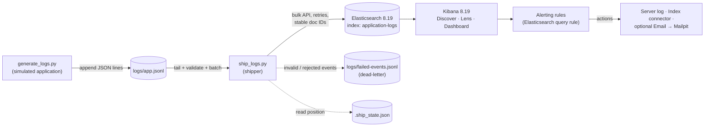

# Real-Time Log Monitoring System Using Elasticsearch and Kibana

A small, fully working log pipeline you can run on one Ubuntu machine:

```
Python log generator → JSONL file → Python shipper (bulk API) → Elasticsearch → Kibana (Discover, dashboard, alert rules)
```

> **Security notice.** To keep the lab simple, Elasticsearch runs with **security disabled** (no passwords, no TLS).
> Ports are bound to `127.0.0.1` in `docker-compose.yml`. This is for **localhost development only**.
> Never expose ports 9200/5601 to a network, a cloud VM's public IP, or the internet.

## 1. Objectives and learning outcomes

After finishing this lab you can:

- explain how an application log line becomes a searchable document in Elasticsearch;
- run a single-node Elastic Stack with Docker Compose, with health checks and a persistent volume;
- design an explicit index mapping (date, keyword, text, numeric, ip fields) and explain why it matters;
- build a reliable shipper: validation, bulk indexing, bounded retries, idempotent document IDs, graceful shutdown;
- build Kibana visualizations and a dashboard, and write KQL filters;
- create alert rules and explain the difference between *an alert firing* and *a notification being delivered*.

## 2. Architecture



More detail: [docs/architecture.md](docs/architecture.md).

## 3. Technology stack

| Component | Version / detail |
|---|---|
| OS | Ubuntu Linux (22.04 / 24.04) |
| Containers | Docker Engine + Docker Compose v2 |
| Elasticsearch / Kibana | **8.19.18**, pinned (set in `.env` as `STACK_VERSION`; both must match) |
| Python | 3.9+ (tested with 3.12) |
| Python libraries | `elasticsearch` 8.x client, `python-dotenv`, `pytest` |
| Log format | JSON Lines, ECS-style field names |

## 4. Prerequisites

- Ubuntu with **≥ 4 GB free RAM** (the stack uses ~1.5 GB) and ~3 GB disk for images.
- Docker Engine and the Compose plugin: `docker --version` and `docker compose version` must both work.
  Install guide: <https://docs.docker.com/engine/install/ubuntu/>. To run Docker without `sudo`:
  `sudo usermod -aG docker $USER` then log out and in.
- Python 3 with venv: `sudo apt install -y python3 python3-venv python3-pip`
- Internet access the first time (to pull images and Python packages).
- Optional kernel setting recommended by Elastic for Linux hosts:
  `sudo sysctl -w vm.max_map_count=262144`

## 5. Installation

```bash
git clone <your-repo-url> log-monitoring-elastic     # or unzip the project
cd log-monitoring-elastic

python3 -m venv .venv                 # isolated Python environment
source .venv/bin/activate             # re-run this in every new terminal
pip install -r requirements.txt

cp .env.example .env                  # local configuration (git-ignored)
```

## 6. Environment configuration

All settings live in `.env` (see `.env.example`). Docker Compose and the Python apps both read it.

| Variable | Default | Meaning |
|---|---|---|
| `STACK_VERSION` | `8.19.18` | Image tag for **both** Elasticsearch and Kibana |
| `ES_PORT` / `KIBANA_PORT` | `9200` / `5601` | Host ports (bound to 127.0.0.1) |
| `ES_HEAP` | `512m` | Elasticsearch JVM heap |
| `KIBANA_ENCRYPTION_KEY` | demo value | ≥ 32 chars; lets alert rules survive Kibana restarts. Change it. |
| `ES_URL` | `http://localhost:9200` | **Elasticsearch endpoint used by the Python apps** |
| `ES_INDEX` | `application-logs` | Target index |
| `ES_API_KEY`, `ES_USERNAME`, `ES_PASSWORD` | empty | Only needed if you enable security |
| `LOG_FILE` | `logs/app.jsonl` | File the shipper reads |
| `SHIP_BATCH_SIZE`, `SHIP_FLUSH_SECONDS`, `SHIP_MAX_RETRIES` | 200 / 2 / 5 | Shipper tuning |

Never commit `.env` or real credentials; `.gitignore` already excludes it, plus `logs/*`.

## 7. Start Elasticsearch and Kibana

```bash
docker compose up -d            # start in the background
docker compose ps               # wait until both show "healthy" (1–3 minutes)
```

Startup order is explicit: Kibana `depends_on` Elasticsearch with `condition: service_healthy`, and both have health checks.
Data is stored in the named volume `esdata`, so it **survives** `docker compose stop/down` but is **deleted** by `docker compose down -v`.

Quick check: `curl -s localhost:9200 | head` should print JSON with `"number" : "8.19.18"`.
Kibana: <http://localhost:5601>.

## 8. Create the index, generate and ingest logs

```bash
# 1) Create the index with the explicit mapping (config/index-mapping.json)
python scripts/setup-index.py

# 2) Terminal A - run the shipper; it follows the file like `tail -f`
python app/ship_logs.py --follow

# 3) Terminal B - generate mixed traffic (one event every 0.5 s)
python app/generate_logs.py
```

What each command does:

- `setup-index.py` creates `application-logs` (1 shard, 0 replicas – right for one node) with **strict** mapping, so
  unexpected fields are rejected rather than silently guessed. `--recreate` deletes and rebuilds the index.
- `ship_logs.py --follow` reads new lines, validates them, sends them in bulk batches, and remembers its position in
  `logs/.ship_state.json`. Bad lines go to `logs/failed-events.jsonl`.
- `generate_logs.py` options: `--interval 0.2`, `--count 500`, `--profile normal|warnings|errors|mixed`,
  `--spike 12` (burst of 12 ERROR events, then exit), `--seed 42`, `--output FILE`. Stop with Ctrl+C.

Without `--follow` the shipper sends what is in the file now and exits – handy for scripted tests.

### Log event example

```json
{"@timestamp":"2026-10-14T09:15:02.318Z","log":{"level":"ERROR"},"message":"Database connection failed: could not connect to db-primary:5432",
 "service":{"name":"payment-service"},"host":{"name":"web-02"},
 "http":{"request":{"method":"POST"},"response":{"status_code":503}},"url":{"path":"/api/orders"},
 "event":{"id":"3f0c…","duration":2415000000},"source":{"ip":"10.14.77.9"},"error":{"type":"DatabaseConnectionError"}}
```

`event.duration` is in **nanoseconds** (Elastic Common Schema convention): 2 415 000 000 ns = 2.4 s.

## 9. Verify indexing

```bash
python scripts/verify-elasticsearch.py                 # health, count, per-level counts, latest events

curl -s 'localhost:9200/application-logs/_count?pretty'
curl -s 'localhost:9200/application-logs/_search?size=2&sort=@timestamp:desc&pretty'
curl -s 'localhost:9200/application-logs/_mapping?pretty'
curl -s -H 'Content-Type: application/json' 'localhost:9200/application-logs/_search?size=0&pretty' \
     -d '{"aggs":{"levels":{"terms":{"field":"log.level"}}}}'
```

## 10. Kibana dashboard creation

Open <http://localhost:5601>. **Nothing in Kibana is created automatically** – follow these steps once.
Menu names can differ slightly between Kibana minor versions.

### 10.1 Create the data view

☰ menu → **Stack Management → Data Views → Create data view**
- Name: `Application Logs`
- Index pattern: `application-logs`
- Timestamp field: `@timestamp` → **Save data view to Kibana**

### 10.2 Explore in Discover

☰ → **Discover**, choose the `Application Logs` data view, set the time picker (top right) to **Last 15 minutes**
and enable auto-refresh (e.g. every 5 s). If you see "No results", the time range is the usual cause.

Useful KQL filters (type into the Discover/Lens search bar):

| Purpose | KQL |
|---|---|
| Only errors | `log.level : "ERROR"` |
| Errors or warnings | `log.level : ("ERROR" or "WARNING")` |
| HTTP 500s | `http.response.status_code : 500` |
| Any server error (5xx) | `http.response.status_code >= 500` |
| Client errors (4xx) | `http.response.status_code >= 400 and http.response.status_code < 500` |
| Database failures | `error.type : "DatabaseConnectionError"` |
| Auth failures | `error.type : "AuthenticationError"` |
| One service's errors | `service.name : "payment-service" and log.level : "ERROR"` |
| Slow requests (> 2 s) | `event.duration > 2000000000` |
| Full-text search | `message : "connection failed"` |

Save the error query as a Discover saved search named **Recent Errors**: query `log.level : "ERROR"`, add columns
`@timestamp`, `service.name`, `http.response.status_code`, `message`, sort by `@timestamp` descending → **Save**.

### 10.3 Build the visualizations (Lens)

☰ → **Visualize Library → Create visualization → Lens** (data view: `Application Logs`). Save each one with the panel
name below. (You can also create them directly from the dashboard with **Create visualization**.)

| # | Panel name | Lens chart | Configuration |
|---|---|---|---|
| 1 | **Total Log Events** | Metric | Primary metric: **Count of records** |
| 2 | **Errors** | Metric | Metric: Count of records; search bar KQL `log.level : "ERROR"` |
| 2b | **Warnings** | Metric | Same, KQL `log.level : "WARNING"` |
| 3 | **Logs Over Time** | Bar vertical stacked (or Line) | X: **Date histogram** on `@timestamp` (interval: Auto or 30 seconds); Y: Count; Break down by: Top values of `log.level` |
| 4 | **Logs by Severity** | Donut (or Bar) | Slice by: Top values of `log.level` (size 5); Size: Count |
| 5 | **HTTP Status Codes** | Bar vertical | X: Top values of `http.response.status_code` (size 10, ordered by Count); Y: Count |
| 6 | **Top Services with Errors** | Bar horizontal | KQL `log.level : "ERROR"`; Vertical axis: Top values of `service.name` (size 10, rank by Count); Horizontal: Count |
| 7 | **Recent Error Messages** | Add the saved search **Recent Errors** (dashboard → *Add from library*) | Shows newest error rows with message text |

Tip for panel 2: you can combine errors and warnings in one Metric using two layers, but two small Metric panels are
simpler for beginners.

### 10.4 Create the dashboard

☰ → **Dashboards → Create dashboard** → **Add from library** → add all panels →
set time range **Last 15 minutes** and refresh **5 seconds** → **Save** with title
**`Real-Time Application Log Monitoring`** (tick "Store time with dashboard").
Layout suggestion: row 1 – Total / Errors / Warnings; row 2 – Logs Over Time (wide) + Logs by Severity;
row 3 – HTTP Status Codes + Top Services with Errors; row 4 – Recent Error Messages (wide).

> Kibana can export dashboards as saved objects (Stack Management → Saved Objects → Export). If you do, commit the
> `.ndjson` file to `kibana/` so others can import it. This repo does not ship one, because it cannot be verified
> without a running Kibana.

## 11. Alert configuration

Alert rules need manual setup too. The rules below use the **Elasticsearch query** rule type.
Check <https://www.elastic.co/subscriptions> for what your license level includes: with the default
**Basic** license, this rule type and the *Server log* and *Index* connectors are available;
verify the *Email* connector and any third-party connectors (Slack, PagerDuty, Teams, Jira …) against that page.

### 11.1 Rule 1 – "5 or more ERROR events in 5 minutes"

☰ → **Stack Management → Rules → Create rule** → **Elasticsearch query**

| Setting | Value |
|---|---|
| Name | `High error rate (>= 5 ERROR in 5 min)` |
| Check every | `1 minute` (the minimum may be raised by the cluster's `xpack.alerting.rules.minimumScheduleInterval`; default is 1 m) |
| Query type | **KQL** (or Query DSL), data view `Application Logs` |
| Query | `log.level : "ERROR"` |
| Size | 100 |
| Time window / "Last" | `5 minutes` |
| Condition | **IS ABOVE** `4` (equivalent to ≥ 5; use "is above or equals 5" if your version offers it) |

**Actions** (click *Add action* – you can add several):

1. **Server log** connector (free, built in). Run when: *Query matched*. Message: `ERROR spike: {{context.hits}} …` or the default
   message. This writes a line to Kibana's log: `docker compose logs kibana | grep -i "error rate"`.
2. **Index** connector → create a connector named `alert-notifications-index` writing to index
   `alert-notifications`. Document: `{"rule":"{{rule.name}}","date":"{{date}}","message":"{{context.message}}"}`.
   Create a data view on `alert-notifications` to see the documents in Discover.
3. *(Optional)* **Email** connector – see 11.3.

Set the action frequency to **On status change** (notify when the alert becomes active) so you are not flooded
every minute while the spike persists. Save the rule.

### 11.2 Rule 2 – repeated HTTP 500 responses

Same steps; name `Repeated HTTP 500 (>= 3 in 5 min)`; KQL `http.response.status_code : 500`; window 5 minutes;
condition **IS ABOVE 2**.

### 11.3 Optional real notification: email into Mailpit

```bash
docker compose --profile mail up -d      # starts a fake SMTP server + web inbox
```

Stack Management → **Connectors → Create connector → Email**: Name `mailpit`; Sender `alerts@localhost.test`;
Host `mailpit`; Port `1025`; **Secure** off; **Authentication**: none. Add it as an action to the rule
(To: `ops@localhost.test`). Delivered emails appear at <http://localhost:8025>.

### 11.4 Alert generated ≠ notification delivered

| Stage | What it means | Where to see it |
|---|---|---|
| Rule **runs** | Kibana executed your query on schedule | Rule details → *Execution history* |
| Alert **active** | The condition was met – an alert exists | Rule details → *Alerts* tab / rule status "Active" |
| Action **executed** | Kibana *tried* to run the connector | Rule execution history (action counts); Kibana log |
| Notification **delivered** | The target really received it | Index document in `alert-notifications`; email in Mailpit; message in Slack, etc. |

An alert can be active while delivery fails (wrong SMTP host, blocked network, expired token). Always verify at the
destination. Because this lab has no real mail server or chat service, **Index connector documents and Mailpit are the
only deliveries you can prove locally**.

## 12. Testing procedures

All commands assume the venv is active and you are in the project root. Use a fresh index for clean counts:
`python scripts/setup-index.py --recreate && rm -f logs/app.jsonl logs/.ship_state.json`

Set a handy shortcut: `COUNT() { curl -s 'localhost:9200/application-logs/_count' ; echo; }`

| # | Scenario | Commands | Expected outcome |
|---|---|---|---|
| 1 | Normal INFO logs | `python app/generate_logs.py --profile normal --count 50 --interval 0.02` then `python app/ship_logs.py` | Shipper prints `Indexed 50 event(s)`; all docs `INFO`/`DEBUG` |
| 2 | WARNING events | `python app/generate_logs.py --profile warnings --count 30 --interval 0.02` then `python app/ship_logs.py` | 30 more docs; 404/401/403/slow warnings |
| 3 | HTTP 500 + ERROR | `python app/generate_logs.py --profile errors --count 20 --interval 0.02` then `python app/ship_logs.py` | 20 more docs, all `ERROR`, statuses 500/503 |
| 4 | Verify in Elasticsearch | `python scripts/verify-elasticsearch.py` | Total 100; `by log.level` roughly INFO/DEBUG 50, WARNING 30, ERROR 20 |
| 5 | Verify in Kibana | Discover, time range *Last 15 minutes*, query `log.level : "ERROR"` | 20 hits; dashboard panels show non-zero values |
| 6 | Trigger the alert | Keep `ship_logs.py --follow` running, then `python app/generate_logs.py --spike 12` | Within ~1–2 minutes rule 1 turns **Active**; Server-log line and `alert-notifications` document appear (Mailpit email if configured). Rule 2 fires if ≥ 3 of the errors are HTTP 500 (very likely with 12; use `--spike 20` to be sure) |
| 6b | Recovery | Wait 5+ minutes without new errors | Alert becomes **Recovered** when the window no longer holds ≥ 5 errors |
| 7 | Stop/restart services | `docker compose stop` → `docker compose start` → `docker compose ps` | Both become healthy again; `_count` is unchanged (volume persisted); dashboards/rules still exist |
| 7b | Shipper outage | With the shipper following: `docker compose stop elasticsearch`; generate some logs; wait; `docker compose start elasticsearch` | Shipper logs `Retry n/5` warnings, then `Could not deliver batch … Position NOT advanced`; after ES is healthy again it ships the backlog. Count rises by exactly the number generated (no duplicates, no loss) |
| 7c | Clean shutdown | Press Ctrl+C in the shipper terminal | Logs `Shutdown requested - flushing pending events` and `Finished. stats=…`; exit code 0 |
| 8 | Diagnose failures | See [docs/troubleshooting.md](docs/troubleshooting.md) | — |

Automated unit/integration tests (no Docker needed – they use a tiny fake Elasticsearch server):

```bash
python -m pytest -q          # 18 tests: generator profiles, validation, retries, restart, outage, shutdown
```

### What was actually verified while building this project

- ✅ **Executed:** the 18 pytest tests pass (Python 3.12, `elasticsearch` 8.19 client against a fake HTTP server);
  an end-to-end run of the real `generate_logs.py` and `ship_logs.py` processes (28 events shipped, SIGTERM exit code 0);
  `docker-compose.yml` parses as valid YAML; `index-mapping.json` parses; all Python files compile.
- ⚠️ **Not executed** (the build environment had no Docker or internet access to Elastic's registry): starting the real
  Elasticsearch/Kibana containers, `setup-index.py` and `verify-elasticsearch.py` against a real cluster, all Kibana
  UI steps (data view, Lens, dashboard) and alert rules. Those instructions are written from Elastic's documented behavior for 8.19
  and **must be validated on your machine**. If a menu label differs, follow Kibana's equivalent.

## 13. Troubleshooting (quick version)

| Symptom | Likely cause / fix |
|---|---|
| `docker compose ps` shows Elasticsearch restarting | Low memory or `vm.max_map_count`: `sudo sysctl -w vm.max_map_count=262144`; check `docker compose logs elasticsearch` |
| `memory locking requested … but memory is not locked` | Remove `bootstrap.memory_lock=true` from the compose file |
| Python: `Connection error` | Stack not healthy yet, wrong `ES_URL`; run `curl localhost:9200` |
| Shipper: `Index 'application-logs' does not exist` | Run `python scripts/setup-index.py` |
| Events appear in `failed-events.jsonl` | Read the `reason` field – validation or mapping problem |
| Kibana "No results" | Time picker too narrow, shipper not running, or wrong data view |
| Kibana shows "not ready" | Wait; check `docker compose logs kibana` |
| Alert never fires | Rule schedule, time window, KQL typo, errors older than 5 min, shipper stopped |

Full guide: [docs/troubleshooting.md](docs/troubleshooting.md).

## 14. Graceful shutdown

```bash
# 1. Ctrl+C the generator, then Ctrl+C the shipper (it flushes first)
# 2. Stop containers, KEEP data:
docker compose stop            # or: docker compose down
# 3. Stop containers and DELETE all data (index, dashboards, rules):
docker compose down -v
```

## 15. Screenshots checklist (for your report)

- [ ] `docker compose ps` with both services healthy
- [ ] `curl localhost:9200` output showing version 8.19.18
- [ ] Mapping output (`_mapping`) showing field types
- [ ] Generator and shipper running side by side (`Indexed N event(s)` lines)
- [ ] `verify-elasticsearch.py` output
- [ ] Data view configuration
- [ ] Discover with the `log.level : "ERROR"` query
- [ ] Each of the 7 panels, and the full dashboard `Real-Time Application Log Monitoring`
- [ ] Rule 1 and Rule 2 configuration pages
- [ ] Alert in *Active* state (rule details → Alerts) after `--spike`
- [ ] `alert-notifications` document in Discover and/or the Mailpit email
- [ ] Shipper outage test log (retries, then recovery)
- [ ] `pytest` result

## 16. Limitations and future enhancements

**Limitations**
- Single node, security off, no TLS → not production-safe. Dashboards and alert rules are manual, not provisioned.
- Single index `application-logs` with no lifecycle policy; it grows until you delete it.
- The shipper follows one file; if a file is rotated while lines are still being appended to the old file, a few trailing lines may be missed.
- `dynamic: strict` mapping rejects unknown fields (by design – they go to the dead-letter file).
- Alert delivery to external systems depends on your connector setup and license.

**Future enhancements**
- Enable security (`xpack.security.enabled=true`, users, API keys, HTTPS).
- Use data streams + ILM (e.g. `logs-app-default`) for rollover and retention.
- Replace the custom shipper with Filebeat or Elastic Agent in production and compare.
- Provision Kibana saved objects and rules via the Kibana API / CI.
- Add an ingest pipeline (GeoIP on `source.ip`), anomaly detection, Slack or webhook connectors.
- Run the generator as several containers, add APM traces.

## 17. Project layout

```
log-monitoring-elastic/
├── docker-compose.yml        Elasticsearch + Kibana (+ optional Mailpit)
├── .env.example  .gitignore  requirements.txt
├── config/index-mapping.json Explicit index settings + mapping
├── app/
│   ├── config.py             Environment configuration + client factory
│   ├── generate_logs.py      Log generator (profiles, --spike)
│   └── ship_logs.py          Shipper (validate, bulk, retry, state, dead-letter)
├── scripts/
│   ├── setup-index.py        Create / recreate the index
│   └── verify-elasticsearch.py  Health, counts, latest events
├── tests/                    pytest suite + fake Elasticsearch server
├── logs/                     Runtime log files (git-ignored)
└── docs/                     architecture, implementation guide (4-hour plan, demo checklist), troubleshooting
```
